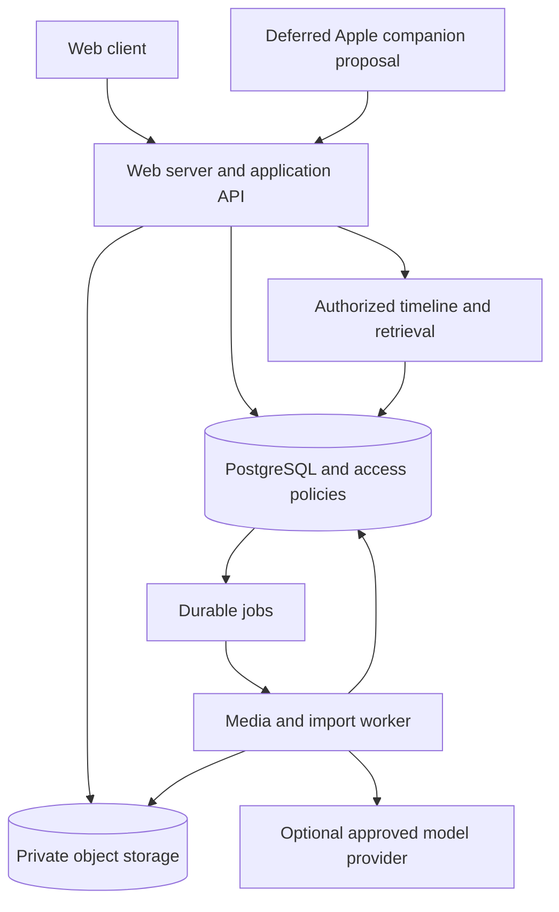

# Mazi architecture

This production architecture is the engineering choice recorded on 5 October 2026 under the delegated M0 task. The existing React Atlas is a separate synthetic prototype; the real local M0 database/storage access experiment passes after fresh migration replay. [M0 acceptance](M0_ACCEPTANCE.md) records the implementation boundary and exact limits.

## One application and one worker deployment

The selected starting stack is a Next.js web application, PostgreSQL, Supabase Auth and private Storage, and a separate long-running worker. PostgreSQL holds application records and a durable job queue. Later proposals include pgvector and a native companion; [D13](DECISIONS.md) confirms website-only current scope and D07 defers native work.

This keeps deployment and transactions manageable for a small team. It does not require microservices, a graph database, a separate search cluster, or an orchestration platform. The archive's relationships fit relational tables. Provider-specific calls stay at authentication, storage, and model boundaries without creating generic wrappers for every query.

Supabase supports database row policies and private object access. Those capabilities do not define Mazi's application policy. Mazi must implement and test its own ownership and audience rules. [RLS documentation](https://supabase.com/docs/guides/database/postgres/row-level-security), [private bucket documentation](https://supabase.com/docs/guides/storage/buckets/fundamentals).

## M0 implementation boundary

Next.js integration begins in M1 and retains the React Atlas UI and plain CSS. MapLibre is deferred to M3, with no map in the pilot. PostgreSQL leases replace PROJECT_PLAN's Inngest choice. M0 uses a local Supabase provider experiment to test database, Auth, and private Storage boundaries without claiming a deployed service.

Dev A owns schema, migrations, authentication, policies, APIs, deployment configuration, and CI. Dev B owns normalized imports, worker stages, adapters, UI, fixtures, and browser/device evidence. Dev A owns shared migration files. Both review changes to availability, authorized reads, and withdrawal before dependent implementation.

## Request and import flow

The server validates identity and current membership before accepting an upload manifest. It creates a contributor-owned, group-scoped import and issues narrowly scoped upload capabilities. Ownership controls mutation; successfully ingested content is readable by every active group member. The client transfers bytes directly to private quarantine storage and confirms completion. The server verifies size and checksum rather than trusting the client manifest.

The worker claims a durable job and validates the file in a restricted process. It computes a cryptographic hash, extracts raw metadata, creates sanitized previews, and records the result. Unsupported media remains a visible item outcome. The worker can retry an item without replaying a whole archive.

Each item becomes available to the entire group automatically when ingestion completes its required validation and retention steps. Availability and discoverable records commit atomically; a failure remains an explicit processing outcome. There is no private archive staging, component grant, or manual publication gate. My Imports supports progress and post-import correction. Search and presentation derive results from available group contributions, excluding cross-group and withdrawn records.

## Pipeline dependencies

The original survives processing. Metadata extraction, preview generation, and optional analysis create versioned derivatives. Hashing and basic metadata arrive in M1 because imports and timeline depend on them, even though richer intelligent processing arrives later in the source brief.

| Stage | Inputs | Result | Required before group availability |
| --- | --- | --- | --- |
| Validation and inventory | Manifest, bytes, bounded archive | Validated items, warnings, quarantine failures | Yes |
| Exact identity | Validated bytes | SHA-256 and permitted duplicate match | Yes |
| Original retention and metadata | Validated bytes | Immutable original, raw metadata assertions | Yes |
| Preview and display date | Original, metadata assertions | Sanitized preview, date with confidence | Yes; unsupported items retain an explicit failure outcome |
| Perceptual matching | Eligible images | Reversible candidate pairs | No; M3 |
| Place normalization | Permitted location evidence | Versioned place assertion | No; M3 |
| Event suggestions | Permitted time/place/grouping | Reviewable memory candidates | No; M3 |
| Embeddings and descriptions | Explicitly enabled media or context | Versioned retrieval documents | No; M5 |
| Face recognition | Authorized images and required consent | Private candidate clusters and confirmed labels | No; optional M5 |
| Memory AI | Authorized retrieval results | Cited answer with coverage limits | No; M6 |

Processing uses available inputs from the authenticated group and any required processing consent. A group index cannot incorporate cross-group or withdrawn context. Model calls are optional and subject to the [privacy policy](PRIVACY.md).

## Jobs and recovery

The initial queue is a PostgreSQL job table with transactional enqueue, bounded leases, retry backoff, attempt limits, and dead-letter inspection. A worker may receive a job more than once. Each stage has a stable idempotency key and records completion only after its output is durable.

Object storage and database writes do not share a transaction. Uploads first receive temporary object identities. A database commit records valid retained objects. A reconciler removes expired unreferenced uploads and retries incomplete cleanup. It never deletes an object with a live authorized contribution reference.

Cancellation stops new work and signals running stages at safe checkpoints. Late results must compare the import and consent version before attaching output. A failed stage does not erase earlier successful stages. The [contracts](CONTRACTS.md) define job identity and lifecycle details.

## Read paths and scale

The design target is up to hundreds of thousands of items per group. The M3 launch load profile is 100,000 logical media items in one group. The M1 manual pilot is capped at 10,000 items and 20 GiB of originals plus previews. These are targets to test, not proven capacity.

Timeline pages use a stable date-and-ID cursor and an undated partition. Thumbnails load on demand in a virtualized grid. APIs return bounded pages, not a whole archive. Candidate duplicate matching uses indexed hashes and constrained time/size buckets instead of comparing every pair. Approximate video matching remains deferred until its cost is justified.

Indexes start with membership, contribution ownership, group and availability, origin identity, memory relationships, and timeline ordering. Full-text search precedes vector search. Embedding dimensions and model version live with each embedding so incompatible models cannot mix accidentally.

Permission filters apply within retrieval before text or media enters a model prompt. Counts, facets, map points, People associations, and memory summaries use the same filtered set. Approximate search must still fill a result page from authorized candidates without leaking rejected records.

## Original delivery and preview safety

An original may contain GPS, device identifiers, or other private metadata even when the UI hides those fields. Default group viewing uses sanitized derivatives, while original delivery uses the same active-membership policy. The UI must accurately describe that imported originals and metadata are shared with the group. A newly available higher-resolution contribution can improve the group rendition automatically; cross-group or withdrawn variants cannot be selected.

The server authorizes every new download capability. Proposed signed URL expiry is at most 60 seconds. Revocation cannot retract already downloaded bytes or a valid bearer URL immediately. Sensitive content requiring strict current authorization uses a mediated endpoint, including locked capsules. Cache keys include viewer scope and policy version, and sensitive responses avoid public caches.

## Deployment and operation

Development, staging, and production use separate databases, object buckets, secrets, and model credentials. CI checks migrations, authorization, imports, and browser journeys before a release. The Atlas prototype has pinned package versions and a lockfile. M1 production and worker dependencies must also be pinned.

Workers have limited concurrency, memory, CPU, archive-expansion, and runtime budgets. Import and model quotas apply per member and group. Provider failure pauses optional enrichment while manual archiving remains usable.

Telemetry records opaque job IDs, stage duration, queue age, failure category, and byte/cost totals. Logs exclude raw messages, filenames with personal information, media, signed URLs, and tokens. Audit logs record automatic availability, withdrawal, membership revocation, role changes, consent changes, exports, deletions, and privileged operations.

Backups cover both database state and objects. A database backup alone cannot reconstruct the archive. A restore drill must reconcile object references, consent state, and deletion tombstones before serving restored data. Rollback plans use backward-compatible migrations and a feature kill switch for optional analysis.

## Capacity and cost decisions

Measure storage, previews, egress, worker CPU, database load, and model usage separately. A planning example of 100,000 items averaging 4 MB requires about 400 GB of originals before previews, backups, or video growth. This arithmetic is an assumption, not a price quote or representative average.

M0 accepted a €75 monthly operating ceiling and pilot quotas in [M0 acceptance](M0_ACCEPTANCE.md). No paid provisioning is authorized during M0. M2 records measured cost per thousand imported items and per stored GB. M5 adds cost per thousand embeddings; M6 adds cost per answered question. Increase infrastructure only after a measured bottleneck. Current vendor pricing must be checked when the budget is approved.
