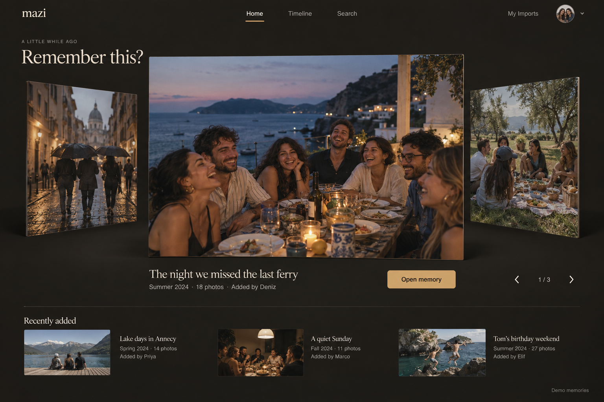
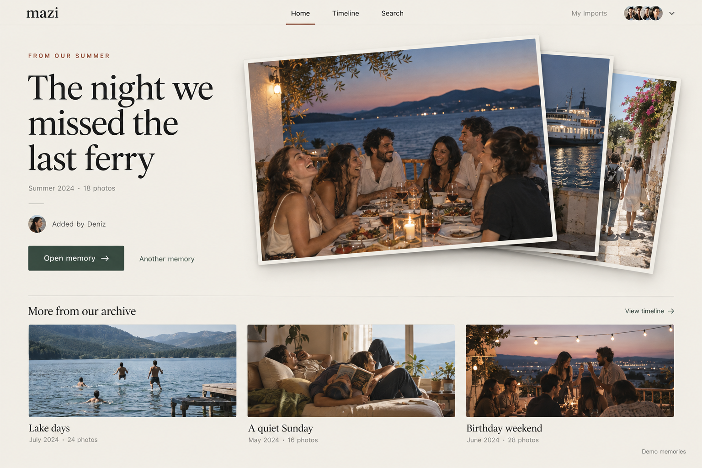
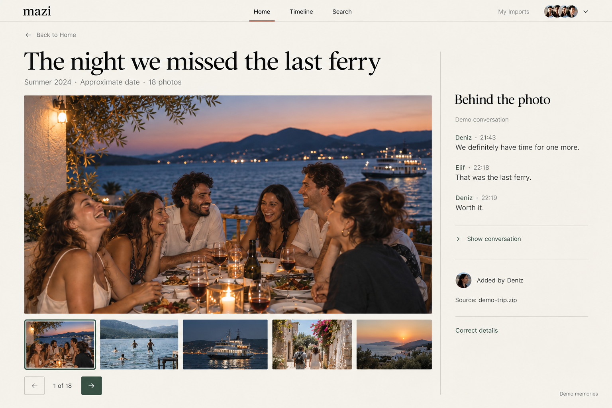
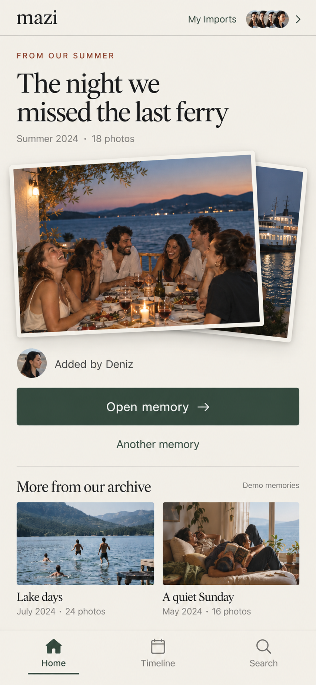

# Mazi visual direction proposal

Current decision, 2026-10-03: the team selected **The Atlas of Us** and authorized the interactive prototype. [D16 / prototype stack](PROTOTYPE_STACK.md) and [runtime evidence](../work/design/atlas/VERIFICATION.md) supersede pending-selection statements in the historical exploration below. The concept remains the visual reference; generated photo counts are replaced by actual fixture counts.

Status: design review, 2026-10-03. The owner requested visual direction, concept images, and an interaction specification, then requested a bolder round through the decision board. The first-round concepts below are retained as exploration, not the current recommendation. These are proposals, not an approved visual system or a working prototype. Product decisions remain in [PRODUCT.md](../PRODUCT.md). The interaction handoff is [HOME_MEMORY_INTERACTIONS.md](HOME_MEMORY_INTERACTIONS.md).

## Current round: bolder structures

The owner selected Re-roll with register `bolder`. Impeccable seed `422333e9`, round 1, therefore deals foreign visual systems; the earlier album, screening room, and consumer-card directions are not re-presented as new options. The [current decision payload](../work/design/home-memory/direction-options-bolder.json) keeps every new system available. No new option has been selected yet.

| Direction | Core spatial idea | Product adaptation | Tradeoff |
| --- | --- | --- | --- |
| Memory Signal | A chronological field of photographic fins opens one selected moment | Real dates replace arbitrary signal data; photographs keep their color; strobing is removed | Highly distinctive, potentially colder and harder to scan |
| Our Panorama | An asymmetric typographic photo panorama with one hinged active tile | Warm coral and real photographs replace cold screen tiles; ordinary labels stay visible | Strong composition with less literal model complexity |
| Return Tickets | An archive board selects a dimensional folded photographic ticket | Events replace flights; no fictitious airports, gates, or barcode workflow | Strong index and opening ritual; travel metaphor may constrain everyday moments |
| An Index of Us | A shoulder index reveals a hinged, bordered photo plate | Personal source context replaces specimen definitions | Intimate and precise; more literary than playful |
| The Memory Garden | Sculptural islands hold existing memories around a dominant photo | Islands represent actual memory groups, never inferred places; all choices remain available in a list | Most playful modeled environment; must avoid obscuring the photographs |
| The Atlas of Us | A curved dated chart selects a large photographic detail | Chronology replaces celestial coordinates; no social graph or literal astronomy data | Strong exploration, with a risk of theme overtaking personal content |

The first dealt system, Memory Signal, leads the board. Panorama and Garden outperform it on the design hypotheses of audience identification and product clarity; Tickets, Index, and Atlas remain competitive on at least one axis. These judgments are design assessments, not user-test findings. All six are presented at full fidelity because the owner requested the bolder register. The familiar photo library remains a standing exit, not a recommendation.

Current images: [Memory Signal](../.impeccable/mocks/decision/bolder-signal.png), [Our Panorama](../.impeccable/mocks/decision/bolder-panorama.png), [Return Tickets](../.impeccable/mocks/decision/bolder-departures.png), [An Index of Us](../.impeccable/mocks/decision/bolder-lexicon.png), [The Memory Garden](../.impeccable/mocks/decision/bolder-garden.png), and [The Atlas of Us](../.impeccable/mocks/decision/bolder-atlas.png).

Treat incidental handwriting or sentimental copy introduced by generation as optional visual noise, not source evidence or an approved brand voice. In particular, the Signal and Panorama studies introduce lettering outside the requested type system; omit it from a later faithful implementation unless the owner selects it explicitly. Tickets illustrates a date more precisely in its index than its caption; use the same date certainty in both. All controls rendered on a dimensional object need level, semantic equivalents. No visual choice authorizes rasterized interactive text.

## The design problem

Eight friends contribute to one shared archive. Opening Home should make an ordinary remembered moment worth revisiting; opening that memory should reveal its photographs and source context without learning camera controls. Home is primarily an Operate surface, with an expressive photographic browsing region. It is not a public landing page.

The cultural starting point is friends revisiting a trip together: passing an album around, projecting photographs, and remembering details from each other's contributions. This is a design hypothesis, not observed research. Avoid both the default infinite photo grid and its predictable opposite, a free-flying universe of photographs. The approved astronomy reference contributes focused spatial selection beside conventional controls; its space theme does not carry over.

## Earlier round: retained exploration

| Direction | Visual system | First experience | Main tradeoff |
| --- | --- | --- | --- |
| The Screening Room | Warm charcoal, ivory typography, amber action, shallow illuminated photo planes | A central memory in focus, neighboring memories visible in depth, an explicit Open memory button | Strong atmosphere; must remain quick and understandable |
| The Living Album | Warm ivory, forest-green controls, editorial serif titles, precise sans labels, matte photo edges | One large photographic stack beside a title; opening the stack reveals the memory | Best fit for warmth and photography; album imagery is familiar |
| The Everyday Collection | Warm tinted ground, white rounded cards, humanist sans, one action color | Featured photo stack above straightforward recent memories | Very clear; less distinctive |
| The familiar photo library | Neutral canvas, flat thumbnails, conventional chronological grouping | Featured memory followed by a direct photo grid | Efficient, with less of the requested spatial identity |

The Living Album was the first-round recommendation because it connects depth to the actual structure of a memory: several contributions held together. The owner requested bolder alternatives instead of selecting it. Its detail and mobile concepts below remain illustrative studies, not approval or the final direction.

### Proposed material and typography

For the Screening Room, use warm charcoal `#211F1C`, light reading ink `#F4EBDD`, amber action `#CBA779`, and muted sage `#9CADA4`. Reserve shadows and depth for the photo stage; controls and context panels stay stable and opaque.

For the Living Album, use warm ivory `#F3EFE6`, dark ink `#262B27`, forest action `#355347`, and clay detail `#985038`. Photography supplies saturated color. Use subtle photo thickness and a grounded shadow, without fake torn paper, tape, stickers, or aged filters over contributed images.

Proposed typography for the two principal directions: [Newsreader](https://github.com/productiontype/Newsreader) for memory titles and [DM Sans](https://github.com/googlefonts/dm-fonts) for navigation, captions, forms, and source context. Newsreader's upstream describes it as designed for on-screen reading and distributes it under SIL OFL 1.1. The referenced DM family repository is archived; choose and verify an actual distribution and its license at implementation. These are candidates, not a claim that generated lettering exactly matches them. Measure available fonts against the selected comp before installation. Body copy starts at a proposed 16-18 CSS px; essential controls must never use decorative lettering.

Shared component language: persistent labeled navigation, one clear primary action per region, minimal framing around photography, visible focus, restrained corner treatment, and secondary text that stays readable. Dense Timeline, Search, and My Imports screens inherit the palette and type hierarchy while prioritizing scanability.

## Concept content

Every person, image, title, contributor, date, and count in the comps is synthetic demonstration material. The selected example is 'The night we missed the last ferry', Summer 2024, 18 photos, contributed by Deniz. This is fixture content, not a claim about the owner's friends. No real archive is needed for this experiment.

Concept images are stored in [the decision image folder](../.impeccable/mocks/decision/). Their exact generation prompts and unapproved status travel in adjacent JSON files. These images test appearance; they cannot prove motion, accessibility, or performance, and they are not usable 3D meshes.

### The Screening Room

### The Living Album

### Opening a memory in the Living Album

The detail proposal keeps source conversation alongside a level photograph. In implementation, preserve the actual selected photo bytes and identity through the transition; the generated detail image is a newly rendered illustration, not proof of image continuity.

### Phone composition

This portrait comp demonstrates the proposed hierarchy. It does not establish exact CSS dimensions or a tested viewport. Test real title wrapping, target sizes, image bounds, and persistent navigation in the prototype.

### Other options

View [The Everyday Collection](../.impeccable/mocks/decision/everyday-collection.png) and [the familiar photo library](../.impeccable/mocks/decision/photo-library.png). Both remain unapproved alternatives. Two visible generation defects must not carry into implementation: the Everyday Collection duplicates desktop navigation at the bottom, and the familiar library adds an inaccurate '+8' avatar overflow indicator. The canonical group limit remains 8-10 people. The single navigation treatment and real membership count take precedence over those details.

## Direction exploration record

The seven grounded candidates span publications, shared spaces, calendar systems, and conversation:

1. Editorial travel album: personal photographs with a clear editorial reading order.
2. Record-sleeve listening library: memorable covers and compact track-like contents, with a risk of suggesting audio.
3. Shared picnic table: objects clustered by an event, with a risk of decorative clutter.
4. Screening room: focused photographic depth and a familiar ritual of looking together.
5. Yearbook calendar: temporal orientation and recurring dates, with a risk of making Home only about anniversaries.
6. Walking itinerary: shared moments encountered in sequence, with a risk of inventing geographic relationships.
7. Annotated conversation margins: photographs anchored to what friends actually said, with a risk of excessive reading density.

Impeccable direction seed `422333e9`, Operate mode, assigned candidate 4. The top-ranked album remains a full alternative. Catalog challengers and their explicit judgments are retained in [the decision payload](../work/design/home-memory/direction-options.json). The warm consumer surface remains competitive on clarity. Other systems contribute alignment discipline, clear event grouping, a visible return path, deliberate metadata, and stable navigation; they do not contribute their decorative motifs.

## Review and completion boundary

Choose a visual direction and identify any elements that feel wrong. The concept and interaction work can then be consolidated around that selection. No framework, renderer, model service, production asset, implementation, or deployment is selected here. DESIGN.md should describe the eventual built and reviewed system; this proposal must not masquerade as that final record.
