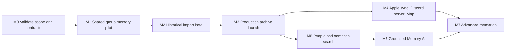

# Mazi roadmap

Build a private archive that a small team can operate in production. Deliver automatic group sharing, post-import correction, and rediscovery on the website. Native synchronization and conversational AI remain later proposals.

Status on 5 October 2026: M0 is complete for the narrowed manual pilot. [M0 acceptance](M0_ACCEPTANCE.md) links the real local provider and browser evidence. [D13-D15](DECISIONS.md) confirm one 8-10-person group, website-only current scope, immediate group sharing, and the design experiment. M1-M7 remain unstarted. The [specification](SPEC.md) owns release scope, and the [test plan](TEST_PLAN.md) owns test definitions.

## Use the planning assumptions

Use the confirmed two-developer allocation. Dev A owns platform/access; Dev B owns experience/ingestion. Both own tests and review. Native capacity is a separate staffing decision if M4 native work is approved.

The user confirmed two developers on 3 October 2026. Use the [two-developer delivery plan](TWO_DEVELOPER_PLAN.md) for task allocation and parallel handoffs. The 5 October M0 decision replaces the earlier three-engineer M1-M3 estimates.

Treat durations as elapsed working-week ranges for that squad, including integration and review. These are planning estimates, not commitments or measured velocity. Re-estimate after M0 and after the first real archive. Do not convert these ranges to launch dates until capacity, supported formats, and infrastructure costs are agreed.

After M0, plan M1 at 6-8 working weeks, M2 at 4-6, and M3 at 4-6. Reserve 3-5 weeks for compatibility, security findings, and stabilization. The remaining two-developer envelope is 17-25 working weeks. This is a rough planning range, not a launch date.

## Follow the dependencies

Run M4 and M5 in parallel only with separate capacity. Otherwise finish M4 before M5, or prioritize M5 if beta demand favors discovery. Manual-format research starts in M0; promised chat-export support requires representative M2 fixtures. Native research and delivery are deferred until a new scope decision; they are not current website launch gates. M4 native tasks below describe that conditional future path.

## Deliver each milestone

| ID | Outcome | Dependencies | Estimate | Accountable role |
| --- | --- | --- | --- | --- |
| M0 | Validated scope, representative fixtures, privacy decisions, architecture experiment results. | None | 1 to 2 weeks | Technical lead with product lead |
| M1 | Members import manual JPEG/PNG into the shared group archive automatically, correct it, and revisit memories. | M0 gates | 6 to 8 weeks | Backend lead with web engineer |
| M2 | Closed beta can reconstruct history from supported archive exports. | M1 | 4 to 6 weeks | Import engineer |
| M3 | Production launch with useful discovery, safe suggestions, recovery, and measured scale. | M2 | 4 to 6 weeks | Technical lead with QA |
| M4 | Selective Apple synchronization, authorized Discord server intake, and map exploration. | M3; source-specific feasibility | 5 to 8 weeks | Native/integration lead |
| M5 | Authorized multimodal retrieval and People; recognition only if consent gates pass. | M3 | 4 to 7 weeks | Retrieval lead |
| M6 | Memory AI gives evidence-backed answers with uncertainty. | M5 | 3 to 5 weeks | Retrieval lead with product lead |
| M7 | Recaps, stories, capsules, and media generation shipped as separate increments. | M4 and M6 program exits; individual features use only actual dependencies | Re-estimate per feature | Product lead |

### M0. Resolve the expensive unknowns

- [x] Record the accepted manual pilot scope, limits, two-person capacity, €75 ceiling, and Chrome/Firefox desktop and Android targets in [M0 acceptance](M0_ACCEPTANCE.md).
- [x] Accept Next.js/PostgreSQL/Supabase, one database-lease worker, EU hosting, server readability, departure withdrawal, and retention targets in [Decisions](DECISIONS.md).
- [x] Establish synthetic manual JPEG/PNG fixtures and declare unsupported formats. M1 must implement validation and explicit unsupported outcomes. Consented chat-export fixtures move to M2 before support claims; store sensitive fixtures outside Git.
- [x] Exercise per-item automatic group availability with a second active member allowed and an outsider/removed member denied at database and storage boundaries.
- [x] Establish the synthetic Atlas prototype and record owner-reported positive feedback from 2-3 friends on 5 October. Record device and reduced-motion evidence separately; 38 browser checks passed with the documented Firefox launcher; physical Android validation is required before the M1 pilot.
- [x] Define Dev A/Dev B ownership and document prototype build/type/test commands. Prettier checks formatting; local provider, browser, type and build checks pass, with CI established.

Exit when accepted storage/privacy decisions, manual fixture/format evidence, and denied database/storage access are recorded in [M0 acceptance](M0_ACCEPTANCE.md). The narrowed pilot does not promise chat exports, HEIC, or video. The real local Supabase suite passes 9/9 checks after a fresh migration replay. A prototype or policy mock alone cannot close this access gate.

M1 uses the manual pilot's hard limits from [M0 acceptance](M0_ACCEPTANCE.md). M2 expands support only after representative export/codec fixtures; M3 retains the 100,000-item release profile. Object backups and a database/object restore drill are required in M1. MapLibre is deferred to M3 and there is no map in the pilot.

### M1. Deliver the shared group memory loop

- [ ] Implement authentication, group membership, single-use expiring invitations, and database authorization.
- [ ] Implement private object storage and resumable manual JPEG/PNG upload with per-item validation and progress.
- [ ] Preserve originals, source appearances, capture-time evidence, and exact duplicate identity within the permitted scope.
- [ ] Deliver immediate per-item group sharing, clear import progress, post-import correction, contribution withdrawal/deletion, and membership revocation. Individual audience controls and private staging are deferred.
- [ ] Deliver manual memories and sub-events, rediscovery Home, paged Timeline, media detail, and keyword search over titles and captions.
- [ ] Add core audit events, migration checks, minimal export, error monitoring, object backups, and a database/object recovery drill.

Exit when two members and one outsider pass tests T01 through T06, T08, and T09 in [Test plan](TEST_PLAN.md). Demonstrate a ten-photo memory with one duplicate, one rejected file, imported group-visible context/location, and revoked membership access. Keep M1 restricted to an internal pilot.

### M2. Import real history

- [ ] Finalize the normalized adapter contract using the existing manual importer.
- [ ] Deliver WhatsApp export support first, then Messenger, then Discord user export. Reorder only if fixture evidence justifies it.
- [ ] Preserve bounded message context, reactions where supplied, source identities, archive coverage, and separate share dates.
- [ ] Add checkpointed scans, queue leases, per-item retry, cancellation, import reconciliation, and human-readable outcome reports.
- [ ] Test common image and video formats against the published format matrix. Reject unsupported codecs clearly.
- [ ] Run the closed beta with the confirmed friend group and the representative archive fixture set. Use separate synthetic groups for isolation tests; additional real groups need a new scope decision.

Exit when T03, T04, T06, T07, and T09 pass, every discovered item has an outcome, and replaying a 20,000-item manifest adds no repeated appearances. Source integrations only claim fields demonstrated by fixtures. Complete the beta group-access walkthrough before the production decision.

### M3. Launch the production archive

- [ ] Add perceptual duplicate suggestions, explicit merge review, split/undo, and authorized rendition selection.
- [ ] Add explainable event suggestions using time, permitted location, and available grouping metadata.
- [ ] Add improved timestamp review, place normalization, approved On This Day, and virtualized timeline views.
- [ ] Complete export, account/group lifecycle controls, retention jobs, monitoring, incident procedures, and restore verification.
- [ ] Run the scale, accessibility, usability, privacy, cost, and release checks below.
- [ ] Release to the agreed invite-only cohort after the product owner records acceptance evidence.

Exit when T01 through T10 and T14 pass against the release candidate, the production checklist is complete, and no unresolved access leak or data-loss defect remains. Visual and event models remain optional. Launch can use reviewed deterministic time/place suggestions without cloud AI.

### M4. Add continuous sources and places

This is a future proposal. Native work requires a new scope decision under D07/D13; it is outside the confirmed website-only work.

- [ ] Ship one native platform first. The proposed default is macOS for bulk imports, followed by iOS after device validation.
- [ ] Add metadata-first selection, album/date/type filters, foreground resumable uploads, change tracking, and permission-revocation handling.
- [ ] Handle Live Photo components and original/edited versions without silently dropping resources.
- [ ] Add Discord bot intake only for selected channels and date ranges with required permissions and an explicit continuous-import switch.
- [ ] Add Map, country/city filters, and optional travel paths derived only from visible places.

Exit when T12 and the source-specific T07 fixtures pass, changed permissions stop ingestion, and one real-device interrupted sync resumes without repeated appearances. Apple-origin People labels are not a promised API capability. Map readiness does not depend on shipping a native companion.

### M5. Add People and semantic retrieval

- [ ] Add versioned visual/text embeddings, combined authorized filters, and a held-out retrieval evaluation set.
- [ ] Add People with manual confirmed associations, separate account/person identities, personal hiding, subject disassociation, and protection against automatic retagging.
- [ ] Enable face recognition only after nonmember consent, withdrawal, provider retention, and deletion choices are settled and tested.
- [ ] Preserve useful search when recognition or all AI processing is disabled.

Exit when T11 passes, T01/T02/T09 remain green for retrieval, and the proposed retrieval target in the test plan is met. Face recognition may remain disabled while semantic search ships.

### M6. Answer with archive evidence

- [ ] Implement retrieval-grounded answers with accessible evidence links and explicit archive-coverage language.
- [ ] Recheck permissions and processing consent before retrieval, provider dispatch, and answer delivery.
- [ ] Treat imported messages as untrusted content. Prevent them from authorizing tools or data access.
- [ ] Add abstention, conflicting-date behavior, deletion invalidation, usage limits, and cost reporting.

Exit when T13 passes on the held-out questions and adversarial cases. Every factual answer is supported by evidence the requesting member can still access. An incomplete archive never supports an absolute claim about the group's entire past.

### M7. Ship advanced memories separately

Prioritize annual recaps and collaborative stories using approved memories. Follow with server-enforced time capsules, richer sub-events, slideshows, and generated video as separate scoped releases. Run T15 before any capsule launch. Define quality, processing cost, and export controls for each generated format before implementation. Notifications are a separate opt-in increment.

## Apply the production gate

- [ ] Record supported source formats, device/browser versions, and upload limits in the product.
- [ ] Pass direct database, storage, API, worker, search, and cache authorization tests.
- [ ] Complete restore, export, deletion, membership-removal, and rollback drills with evidence.
- [ ] Meet the performance and availability targets or record an explicitly accepted revised target before release.
- [ ] Resolve region, provider terms, processing consent, retention, and any required privacy/legal review for the launch cohort.
- [ ] Publish a privacy explanation that distinguishes encryption at rest from end-to-end encryption.
- [ ] Validate keyboard use, screen readers, focus, contrast, progress announcements, and reduced motion.
- [ ] Assign incident ownership, alerts, cost limits, support contact, and a release rollback decision-maker.
- [ ] Review the working flows with the product owner and attach screenshots to the implementation PRs.

## Split work without duplicating documentation

| Workstream | Starts after | Owns | Coordination point |
| --- | --- | --- | --- |
| Identity and access | M0 decisions | Membership, group isolation, ownership, RLS, revocation | Blocks all shared reads. |
| Web experience | M0 journeys | Review, timeline, memory detail, accessibility | Uses the same authorization contract as APIs. |
| Media and jobs | M0 storage experiment | Validation, variants, queue, recovery | Manual import proves the pipeline before other adapters. |
| Archive parsers | M0 fixtures; integration after M1 | Normalization and source compatibility | Can build independent fixture-driven parsers concurrently. |
| Intelligence and retrieval | M2 normalized evidence | Dedupe suggestions, clustering, embeddings, AI | Cannot broaden source visibility or consent. |
| Native Apple | New scope approval and feasibility; conditional M4 | Device authorization and selective sync | Shares the established import contract. |
| Operations and QA | M0 | CI, isolation tests, backups, cost, release evidence | Work proceeds in every milestone. |

Keep the shared specification, architecture, contracts, test plan, and decision register canonical. Create workstream-specific documents only when a contract grows beyond those files. Use one coherent behavior per implementation PR, with failing tests where appropriate, the smallest implementation, and relevant acceptance evidence. Do not create speculative PR numbers or empty workstream folders.
