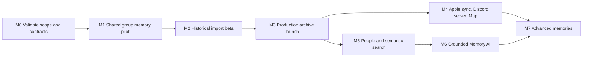

# Mazi roadmap

Build a private archive that a small team can operate in production. Deliver automatic group sharing, post-import correction, and rediscovery on the website. Native synchronization has a local Phase 4 implementation; production native release remains separately gated. D28 retires conversational answers and new story/capsule writing from the active application.

Status on 14 October 2026: M0 is complete for the narrowed manual pilot. [M0 acceptance](M0_ACCEPTANCE.md) links the real local provider and browser evidence. [D13-D15](DECISIONS.md) confirm one 8-10-person group, the initial website-only scope, immediate group sharing, and the design experiment. A separate [local memory-loop experiment](history/identity/README.md) exercises some M1 mechanics but follows the superseded private-staging policy; it is not M1 acceptance evidence. The [Phase 2 import engine](history/imports/README.md) implements local historical ingestion with automatic group availability, adapters, durable jobs and reports. M1/M2 production acceptance remains open. Local Phase 3, Phase 4 and Phase 5 implementations are recorded below; M3-M6 production acceptance and M7 remain open. The [specification](SPEC.md) owns release scope, and the [test plan](TEST_PLAN.md) owns test definitions.

## Current delivery: Globe and Photos

[D28](DECISIONS.md#app-simplification-14-november-2026) and the [approved simplification specification](APP_SIMPLIFICATION_SPEC.md) define Globe and Photos as the primary views, supported by Add and Settings. Search belongs in Photos; individual photographs are grouped by month/year with Undated. Source conversations remain secondary search results and optional viewer context. Annual recap uses reliable capture years; Past creations retains eligible existing content, server capsule locks, exports and authorized deletion only.

[PR #161](https://github.com/dodoscoding/Mazi/pull/161), [the ticket plan](APP_SIMPLIFICATION_TICKETS_DRAFT.md) and [slice evidence](APP_SIMPLIFICATION.md#implementation-status) track local implementation. Final navigation/old-link acceptance remains a separate gate; this record does not close M1-M7, approve deployment or change archive storage. Older release estimates and the retired M6/M7 proposals below remain historical traceability, not authorization to restore answer/story/capsule creation APIs.

## Historical private-social-space increment

On 1 November 2026 the owner selected a private group experience with shared memories, comments, reactions and events under [D25](DECISIONS.md#private-social-space-direction-1-november-2026). The [feasibility investigation](PRODUCT_EVOLUTION_INVESTIGATION.md) proposes four increments: simplify Home/navigation and feature discovery (2/5), reconcile date/place visibility and Search semantics (3/5), add independent People/screenshot/AI filters (3/5), then deliver social interactions in small slices (4/5 overall).

These increments reuse M3 correction, M4 places, M5 People/filtering and M7 stories without declaring those milestones accepted. Native social reactions, comments/activity and future events extend the existing archive scope and need explicit domain and acceptance contracts before implementation. The original M0-M7 program and release gates below remain intact; there is no new production or scheduling commitment in this investigation.

The owner requested the clarity increment first under [D26](DECISIONS.md#interface-clarity-1-november-2026). It separates Home from Atlas, shares Home/Keşfet/Grubumuz navigation across screen sizes and gives existing capabilities named destinations. [Clarity verification](../work/poteto/interface-clarity/VERIFICATION.md) distinguishes local implementation from production and physical-device acceptance. Metadata semantics, content labels and social domains remain separate increments.

The 3 November plan starts with photo-level metadata and navigation on the merged D26 interface. Group plans and attendance can reach a circle with an empty archive while work on content filters proceeds. Comments, reactions and the social Home each have a separate acceptance gate. [Implementation sequence and owners](SOCIAL_SPACE_IMPLEMENTATION_PLAN.md) · [Baseline measurements](../work/poteto/social-space-plan/BASELINE.md)

## Plan Parallel You beside the archive

On 1 November 2026 the owner asked to add Parallel You, an AI alternative-life simulator, under [PY-D1](DECISIONS.md#parallel-you-experiment-1-november-2026). [The plan](PARALLEL_YOU.md) proposes six slices, PY-S1 to PY-S6, of about 13 working days for one developer: the story core and fixture screens first, then a flagged story endpoint, live generation, the game layer, and a story evaluation before release. Its acceptance IDs, PY-A1 to PY-A12, are local to Parallel You.

Parallel You sits outside the M0-M7 program. It does not change those gates and adds no production or scheduling commitment.

## Use the planning assumptions

Use the confirmed two-developer allocation. Dev A owns platform/access; Dev B owns experience/ingestion. Both own tests and review. Native capacity is a separate staffing decision if M4 native work is approved.

The user confirmed two developers on 3 October 2026. Use the [two-developer delivery plan](TWO_DEVELOPER_PLAN.md) for task allocation and parallel handoffs. The 5 October M0 decision replaces the earlier three-engineer M1-M3 estimates.

Treat durations as elapsed working-week ranges for that squad, including integration and review. These are planning estimates, not commitments or measured velocity. Re-estimate after M0 and after the first real archive. Do not convert these ranges to launch dates until capacity, supported formats, and infrastructure costs are agreed.

After M0, plan M1 at 6-8 working weeks, M2 at 4-6, and M3 at 4-6. Reserve 3-5 weeks for compatibility, security findings, and stabilization. The remaining two-developer envelope is 17-25 working weeks. This is a rough planning range, not a launch date.

## Historical program dependencies

This graph preserves the original M0-M7 program; its M6 answer and M7 creation dependencies are superseded by D28. It is not the current implementation queue. Run any retained M4 and M5 production work in parallel only with separate capacity. Otherwise finish M4 before M5, or prioritize M5 if beta demand favors discovery. Manual-format research starts in M0; promised chat-export support requires representative M2 fixtures. The 13 October Phase 4 request authorizes the local macOS implementation below; native production delivery and iOS remain conditional and are not website launch gates.

## Deliver each milestone

| ID | Outcome | Dependencies | Estimate | Accountable role |
| --- | --- | --- | --- | --- |
| M0 | Validated scope, representative fixtures, privacy decisions, architecture experiment results. | None | 1 to 2 weeks | Technical lead with product lead |
| M1 | Members import manual JPEG/PNG into the shared group archive automatically, correct it, and revisit memories. | M0 gates | 6 to 8 weeks | Backend lead with web engineer |
| M2 | Closed beta can reconstruct history from supported archive exports. | M1 | 4 to 6 weeks | Import engineer |
| M3 | Production launch with useful discovery, safe suggestions, recovery, and measured scale. | M2 | 4 to 6 weeks | Technical lead with QA |
| M4 | Selective Apple synchronization, authorized Discord server intake, and map exploration. | M3; source-specific feasibility | 5 to 8 weeks | Native/integration lead |
| M5 | Authorized multimodal retrieval and People; recognition only if consent gates pass. | M3 | 4 to 7 weeks | Retrieval lead |
| M6 | Historical Memory AI proposal, retired from the active app under D28. | M5 | 3 to 5 weeks | Retrieval lead with product lead |
| M7 | Simple capture-year recap and retained Past creations; new stories/capsules and generated media are retired under D28. | M4 and M6 program exits; individual features use only actual dependencies | Re-estimate per feature | Product lead |

### M0. Resolve the expensive unknowns

- [x] Record the accepted manual pilot scope, limits, two-person capacity, €75 ceiling, and Chrome/Firefox desktop and Android targets in [M0 acceptance](M0_ACCEPTANCE.md).
- [x] Accept Next.js/PostgreSQL/Supabase, one database-lease worker, EU hosting, server readability, departure withdrawal, and retention targets in [Decisions](DECISIONS.md).
- [x] Establish synthetic manual JPEG/PNG fixtures and declare unsupported formats. M1 must implement validation and explicit unsupported outcomes. Consented chat-export fixtures move to M2 before support claims; store sensitive fixtures outside Git.
- [x] Exercise per-item automatic group availability with a second active member allowed and an outsider/removed member denied at database and storage boundaries.
- [x] Establish the synthetic Atlas prototype and record owner-reported positive feedback from 2-3 friends on 5 October. Record device and reduced-motion evidence separately; 38 browser checks passed with the documented Firefox launcher; physical Android validation is required before the M1 pilot.
- [x] Define Dev A/Dev B ownership and document prototype build/type/test commands. Prettier checks formatting; local provider, browser, type and build checks pass, with CI established.

Exit when accepted storage/privacy decisions, manual fixture/format evidence, and denied database/storage access are recorded in [M0 acceptance](M0_ACCEPTANCE.md). The narrowed pilot does not promise chat exports, HEIC, or video. The real local Supabase suite passes 9/9 checks after a fresh migration replay. A prototype or policy mock alone cannot close this access gate.

M1 uses the manual pilot's hard limits from [M0 acceptance](M0_ACCEPTANCE.md). M2 expands support only after representative export/codec fixtures; M3 retains the 100,000-item release profile. Object backups and a database/object restore drill are required in M1. MapLibre is deferred to M3 and there is no map in the pilot.

### M1. Deliver the shared group memory loop

- [ ] Implement authentication, group membership, single-use expiring invitations, and database authorization.
- [ ] Implement private object storage and resumable manual JPEG/PNG upload with per-item validation and progress.
- [ ] Preserve originals, source appearances, capture-time evidence, and exact duplicate identity within the permitted scope.
- [ ] Deliver immediate per-item group sharing, clear import progress, post-import correction, contribution withdrawal/deletion, and membership revocation. Individual audience controls and private staging are deferred.
- [ ] Deliver the retained memory structure, Globe/Photos browsing, shared photo detail, and keyword search over titles and captions; D28 retires story sub-event editing.
- [ ] Add core audit events, migration checks, minimal export, error monitoring, object backups, and a database/object recovery drill.

Exit when two members and one outsider pass tests T01 through T06, T08, and T09 in [Test plan](TEST_PLAN.md). Demonstrate a ten-photo memory with one duplicate, one rejected file, imported group-visible context/location, and revoked membership access. Keep M1 restricted to an internal pilot.

### M2. Import real history

Local implementation, 6 October: [Phase 2](history/imports/README.md) provides a shared manual/WhatsApp/Messenger/Discord adapter contract, resumable ZIP transfer, checkpointed inventory, fenced database leases, retry/cancel/reconciliation, source provenance, group-visible photos and paged reports. [Verification](history/imports/VERIFICATION.md) distinguishes synthetic implementation evidence from the production and real-fixture gates below. The production checkboxes remain open until integration and acceptance; video is explicitly unsupported.

- [ ] Finalize the normalized adapter contract using the existing manual importer.
- [ ] Deliver WhatsApp export support first, then Messenger, then Discord user export. Reorder only if fixture evidence justifies it.
- [ ] Preserve bounded message context, reactions where supplied, source identities, archive coverage, and separate share dates.
- [ ] Add checkpointed scans, queue leases, per-item retry, cancellation, import reconciliation, and human-readable outcome reports.
- [ ] Test common image and video formats against the published format matrix. Reject unsupported codecs clearly.
- [ ] Run the closed beta with the confirmed friend group and the representative archive fixture set. Use separate synthetic groups for isolation tests; additional real groups need a new scope decision.

Exit when T03, T04, T06, T07, and T09 pass, every discovered item has an outcome, and replaying a 20,000-item manifest adds no repeated appearances. Source integrations only claim fields demonstrated by fixtures. Complete the beta group-access walkthrough before the production decision.

### M3. Launch the production archive

Local implementation, 6 October: [Phase 3 local archive review](history/archive/README.md) adds a review screen, corrections, Timeline/search, duplicate and event review, approved On This Day, individual source removal, member departure, current-visibility export, local health/metrics and an offline restore drill to the Phase 2 local archive. [Verification](history/archive/VERIFICATION.md) separates those synthetic checks from production acceptance. It is not integrated into the production stack or release candidate; all M3 acceptance and production gates below remain open.

- [ ] Add perceptual duplicate suggestions, explicit merge review, split/undo, and authorized rendition selection.
- [ ] Add explainable event suggestions using time, permitted location, and available grouping metadata.
- [ ] Add improved timestamp review, place normalization, approved On This Day, and virtualized timeline views.
- [ ] Complete export, account/group lifecycle controls, retention jobs, monitoring, incident procedures, and restore verification.
- [ ] Run the scale, accessibility, usability, privacy, cost, and release checks below.
- [ ] Release to the agreed invite-only cohort after the product owner records acceptance evidence.

Exit when T01 through T10 and T14 pass against the release candidate, the production checklist is complete, and no unresolved access leak or data-loss defect remains. Visual and event models remain optional. Launch can use reviewed deterministic time/place suggestions without cloud AI.

### M4. Add continuous sources and places

Local implementation, 13 October 2026: the owner requested Phase 4 implementation, extending the earlier website-only implementation scope with the proposed macOS-first companion. [Phase 4](history/sources/README.md) adds native metadata selection and foreground resumable resource transfer, operator-approved selected-channel Discord polling, and an offline map with country/city filters and optional visible-place paths. Permission changes fence new work; original, edited and Live Photo resources retain separate identities. [Verification](history/sources/VERIFICATION.md) records synthetic and build evidence. This does not approve an iOS release, production deployment or M4 acceptance. Real-device/source fixtures and M3 production dependencies remain open; the release checkboxes below stay unchecked.

- [ ] Ship one native platform first. The proposed default is macOS for bulk imports, followed by iOS after device validation.
- [ ] Add metadata-first selection, album/date/type filters, foreground resumable uploads, change tracking, and permission-revocation handling.
- [ ] Handle Live Photo components and original/edited versions without silently dropping resources.
- [ ] Add Discord bot intake only for selected channels and date ranges with required permissions and an explicit continuous-import switch.
- [ ] Add Map, country/city filters, and optional travel paths derived only from visible places.

Exit when T12 and the source-specific T07 fixtures pass, changed permissions stop ingestion, and one real-device interrupted sync resumes without repeated appearances. Apple-origin People labels are not a promised API capability. Map readiness does not depend on shipping a native companion.

### M5. Add People and semantic retrieval

Local implementation, 13 October 2026: [Phase 5](history/discovery/README.md) adds manual confirmed People, two-party account/person verification, subject suppression and private nonmember review, personal photo/archive-memory hiding, combined authorized filters, and versioned offline text/color embeddings. Optional processing defaults off; recognition and external providers remain disabled. [Verification](history/discovery/VERIFICATION.md) separates the 100-query synthetic regression holdout from independent real-archive acceptance. The 14 October continuation adds an optional checksum-pinned local CLIP text/image model with explicit resumable indexing and a separate 100-query image-retrieval smoke evaluation; the dependency-light baseline remains available. English model queries and the limited generated-image fixture set do not establish representative production quality. Production integration and the release gates below remain open.

- [ ] Add versioned visual/text embeddings, combined authorized filters, and a held-out retrieval evaluation set.
- [ ] Add People with manual confirmed associations, separate account/person identities, personal hiding, subject disassociation, and protection against automatic retagging.
- [ ] Enable face recognition only after nonmember consent, withdrawal, provider retention, and deletion choices are settled and tested.
- [ ] Preserve useful search when recognition or all AI processing is disabled.

Exit when T11 passes, T01/T02/T09 remain green for retrieval, and the proposed retrieval target in the test plan is met. Face recognition may remain disabled while semantic search ships.

### M6. Historical answer-generation proposal

**Superseded by D28:** the following original proposal and evidence are retained for traceability. App answer/answer-consent writes now return 410; exact authorized source evidence remains readable without answer consent. These unchecked items are not an active delivery mandate.

Local implementation, 14 October 2026: [Phase 6](history/answers/README.md) adds local extractive Memory answers with attributed metadata, live evidence links, incomplete-archive language, date-conflict handling, explicit opt-in, permission/consent rechecks, and durable daily usage limits. No external provider or tool dispatch is enabled. [Verification](history/answers/VERIFICATION.md) records synthetic boundary tests and a 150-question templated regression set; it does not establish independent real-archive T13 quality. Production integration and the release gates below remain open.

- [ ] Implement retrieval-grounded answers with accessible evidence links and explicit archive-coverage language.
- [ ] Recheck permissions and processing consent before retrieval, provider dispatch, and answer delivery.
- [ ] Treat imported messages as untrusted content. Prevent them from authorizing tools or data access.
- [ ] Add abstention, conflicting-date behavior, deletion invalidation, usage limits, and cost reporting.

Exit when T13 passes on the held-out questions and adversarial cases. Every factual answer is supported by evidence the requesting member can still access. An incomplete archive never supports an absolute claim about the group's entire past.

### M7. Retain recap and Past creations

Local implementation, 14 October 2026: [Phase 7](history/memories/README.md) delivers the first separate increment: annual recaps from approved, fully visible memories and collaborative stories with member-owned recollections, revision conflicts, departure cleanup, and current-access JSON export. [Verification](history/memories/VERIFICATION.md) records synthetic API and browser checks. The continuation adds isolated server-time capsules, ordered sub-events, authorized manual slideshows, bounded local MJPEG AVI montage export, and opt-in in-app capsule notices. The local author/edit and format controls are recorded in Decisions; these are separate local increments, not production releases. M4/M6 production dependencies and M7 acceptance remain open.

D28 supersedes the authoring/generated-format program above. The retained Annual recap is a capture-year photo collection, oldest first by month, without narration, ranking, editing or video. Past creations preserves eligible stored stories/capsules, export and authorized deletion, including own-recollection withdrawal; server opening times still apply to authors and every media/export path. New story/capsule writes and generated-story media app operations return 410. T15 continues to guard retained capsule access rather than authorizing a new creation release. Production acceptance stays open.

## Apply the production gate

- [ ] Record supported source formats, device/browser versions, and upload limits in the product.
- [ ] Pass direct database, storage, API, worker, search, and cache authorization tests.
- [ ] Complete restore, export, deletion, membership-removal, and rollback drills with evidence.
- [ ] Meet the performance and availability targets or record an explicitly accepted revised target before release.
- [ ] Resolve region, provider terms, processing consent, retention, and any required privacy/legal review for the launch cohort.
- [ ] Publish a privacy explanation that distinguishes encryption at rest from end-to-end encryption.
- [ ] Validate keyboard use, screen readers, focus, contrast, progress announcements, and reduced motion.
- [ ] Assign incident ownership, alerts, cost limits, support contact, and a release rollback decision-maker.
- [ ] Review the working flows with the product owner and attach screenshots to the implementation PRs.

## Split work without duplicating documentation

| Workstream | Starts after | Owns | Coordination point |
| --- | --- | --- | --- |
| Identity and access | M0 decisions | Membership, group isolation, ownership, RLS, revocation | Blocks all shared reads. |
| Web experience | M0 journeys | Review, timeline, memory detail, accessibility | Uses the same authorization contract as APIs. |
| Media and jobs | M0 storage experiment | Validation, variants, queue, recovery | Manual import proves the pipeline before other adapters. |
| Archive parsers | M0 fixtures; integration after M1 | Normalization and source compatibility | Can build independent fixture-driven parsers concurrently. |
| Intelligence and retrieval | M2 normalized evidence | Dedupe suggestions, clustering, embeddings, AI | Cannot broaden source visibility or consent. |
| Native Apple | New scope approval and feasibility; conditional M4 | Device authorization and selective sync | Shares the established import contract. |
| Operations and QA | M0 | CI, isolation tests, backups, cost, release evidence | Work proceeds in every milestone. |

Keep the shared specification, architecture, contracts, test plan, and decision register canonical. Create workstream-specific documents only when a contract grows beyond those files. Use one coherent behavior per implementation PR, with failing tests where appropriate, the smallest implementation, and relevant acceptance evidence. Do not create speculative PR numbers or empty workstream folders.
