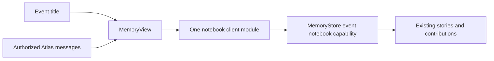

# Event notebook architecture

## Overview

Mazi's canonical memory route identifies an approved event, while imported chat excerpts and member recollections have different owners. The notebook brings both into the existing event page. The selected design is candidate B's event-scoped backend capability with candidate A's single-editor lifecycle, as recorded in [design-judgment.md](design-judgment.md). The implementation follows this design. Commands and results are recorded separately in [VERIFICATION.md](VERIFICATION.md).

## Existing ownership

`mazi/atlas.py:atlas_view` owns authorized Atlas cards. Approved cards use actual event IDs and already include imported `messages` with sender, time and text. Origin payloads store bounded attachment-adjacent excerpts from `mazi/imports/adapters.py:bounded_context`; they are neither complete transcripts nor semantic topic matches. Atlas filters withdrawn origins and requires current reader and origin-owner membership.

`mazi/memories/memories.py:MemoryStore` owns persistent recollections. Events can have many `advanced_stories`; each story has one contribution per author. `_approved` suppresses the entire memory if any original asset becomes unavailable. `_story` applies that policy to story access. `write_story` checks a story-wide revision and changes only the authenticated member's contribution. Member-departure triggers remove contributions and stories owned by departing members.

`src/useArchive.ts` owns selected-group Atlas loading and private-state clearing. `src/MemoryView.tsx` owns the event page, currently showing its photo viewer before the title and conversation. `src/features/memories/mount.js` owns the existing advanced-story surface and demonstrates explicit conflict refresh while retaining drafts.

## Selected feature flow

Event-title links use the event ID and notebook arrival flag on the canonical memory route. The detail page focuses and reveals its notebook heading so text is immediately reachable below the viewer; ordinary photo navigation keeps its viewer-first behavior.

The event-scoped GET returns every eligible story and contribution with safe author labels. The write command validates event/story association, author ownership and revision. For a first note it selects or creates a story and writes within one archive transaction. A repeated first-save request conflicts instead of silently overwriting. No schema change is needed.

The client receives explicit group/event identity and keeps one active editor targeting an exact saved story. Conflict refresh updates saved context while retaining the draft and requiring another explicit Save. Recoverable failures retain drafts. Hidden/pagehide, access loss, group changes and unmount clear private notes and drafts, abort requests and invalidate late responses. Sample and standalone-photo modes make no notebook requests.

## Gotchas

Never select only the first story or collapse notes by author: historical repeated-author notes must remain visible. Never nest existing transaction-owning create/write methods inside the new command. SQLite and PostgreSQL use different transaction adapters; the local two-connection concurrency test proves SQLite serialization; hosted concurrency remains unexercised. Removing a note deletes its contribution, not its story. Separate Atlas and notebook reads do not provide push revocation; each request must retain full authorization.
