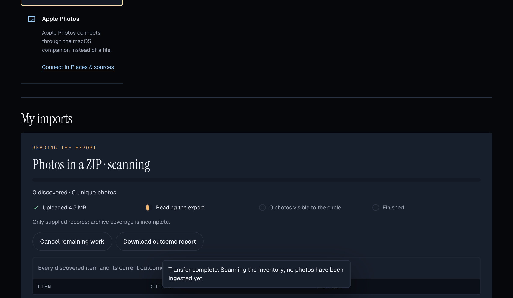

# Import continuity verification

## Result and scope

All three requested fixes were implemented in order: preserve browser upload ownership while hidden; remove repeated ZIP materialization and duplicate hosted readbacks; allow unreclaimed slow work to complete while retaining transactional ownership and access checks. This is synthetic local acceptance for PR #92, not production deployment acceptance.

Baseline: `a2ed798dbc346108a1883725f779b147ce050cd4`. Full local suites and independent behavioral review ran at `b7100755b75cb12dd181e7879281ad130c6e1fd4`. Main's brand-only commit `ef4ef69b139e65010d35c9d2a96a22cff7b4f7be` was integrated as `733afc9310398306ed53a6bef512358e7e84ecef`; build and native acceptance passed again at that revision. Subsequent changes only retain verification evidence.

## Native Mac background acceptance

[Machine-readable evidence](evidence.json) records three successful runs. The last run uses the retained [native probe](native-probe.mjs) on macOS arm64 with Playwright 1.63.0's Chromium 153. The probe connects to a normally launched browser using `connectOverCDP(..., {noDefaults: true})`; ordinary Playwright focus emulation otherwise hides the lifecycle failure. No visibility property or event is injected.

The earlier runs exercised native browser tab/window/full-screen transitions through computer-use controls. The post-main run observed another real hidden-to-visible lifecycle. These prove actual browser background behavior; a particular trackpad swipe between macOS Spaces was not separately recorded.

- A synthetic 80-photo ZIP contains 4,700,761 bytes. The second chunk is held after the first 262,144-byte acknowledgment.
- After the browser reports `document.hidden`, the chunk is released. The same mounted import receives all bytes and reaches INVENTORIED while still hidden.
- Returning preserves the selected File and account label. Exactly one finish request occurs, with no failed import request or page error.
- After confirmation, the page closes. The independent API observer reports COMPLETED with 80 AVAILABLE_TO_GROUP photos.



Reproduce from the repository root in two terminals, using a temporary synthetic archive server:

```sh
npm run build
MAZI_BACKEND=local MAZI_IMPORT_PORT=8039 .venv/bin/python -m tests.browser.memories_server
```

```sh
MAZI_NATIVE_OUTPUT=/tmp/mazi-native-import node work/poteto/import-continuity/native-probe.mjs
```

When the probe prints READY FOR NATIVE SCREEN SWITCH, switch away using native Mac controls. Wait for INVENTORIED WHILE HIDDEN, then return. The probe confirms, closes its page, checks backend completion, writes its JSON/screenshots, and exits. Stop the temporary server afterward. The default port 8039 and browser debug port 9229 must be free. Use MAZI_NATIVE_BASE_URL and MAZI_NATIVE_DEBUG_PORT to select alternatives.

## Regression and performance evidence

Failing behavioral commits precede the corresponding fixes. Frontend regressions cover hidden upload, foreground session validation, changed identity, denied access, Circle retention, and mounting while hidden. Backend regressions cover archive reuse and cleanup, manifest corruption, readback conflict/corruption, slow preparation, real token takeover, cancellation, withdrawal, membership/source revocation, expired initial ownership, and retry limits.

A synthetic 20-photo hosted-storage probe reduced processing ZIP materializations/downloads from 20 to 1, and ZIP bytes read from 368,640 to 18,432 (95% fewer). Hosted chunk verification changed from one POST plus two GETs to one POST plus one GET before acknowledgment. These are measured IO counts, not production network latency or a general throughput guarantee.

## Local checks

All commands ran with the locked local dependencies on 22 October 2026. MAZI_BACKEND=local was used for runtime suites.

| Command | Result |
| --- | --- |
| `npm run lint` | Pass |
| `npm run build` | Pass, existing bundle-size warning |
| `npm run check:docs` | Pass |
| `git diff --check` | Pass |
| `npm run test:unit` | 13 passed |
| `npm run test:dom` | 108 passed |
| `npm run test:backend` | 427 run, 11 skipped, no failures |
| `npm run eval:retrieval` | 100 synthetic queries, recall@10 1.0, 3/3 privacy probes |
| `npm run eval:answers` | 150 synthetic questions, zero failures |
| `MAZI_TEST_PORT=5187 npm test` (Chromium projects) | 118 passed, 18 conditional skips |
| `MAZI_TEST_PORT=5188 MAZI_FIREFOX_EXECUTABLE=/tmp/mazi-import-fixes/firefox/firefox npx playwright test --project firefox-desktop --project firefox-phone --workers=2` | 114 passed, 22 conditional skips |
| `MAZI_UNIFIED_PORT=8067 npm run test:app` | 34 passed |
| `MAZI_PYTHON=.venv/bin/python npm run test:domains` | 22 passed, 2 optional-model skips |
| `MAZI_UNIFIED_PORT=8067 npx playwright test --config playwright.imports.config.ts` | 19 passed, 1 conditional skip |

Stock Firefox failed before application startup with the known profile-folder error. The successful Firefox run used the existing documented [isolated launcher workaround](../m0-acceptance/FIREFOX_ENVIRONMENT.md), leaving the installed engine and user profile untouched. The initial combined shell run therefore exited unsuccessfully; all Chromium cases passed and Firefox cases were rerun successfully with that explicit workaround. Phone projects emulate viewports, not real devices. Backend emitted nonfatal existing resource warnings. Hosted Postgres/provider and optional learned-model acceptance require their separate environments and were not claimed here.

## Review and shipping

Two independent review axes found no blocking issues: specification/behavior and repository standards. The behavioral reviewer separately ran 70 backend tests and four new desktop browser regressions successfully. Two optional P3 readability observations remain: duplicated route-retention predicates and positional archive-session fields. Final immutable-head review is recorded on PR #92.

GitHub Actions run 39776250066 did not start its jobs: GitHub reported failed account payments or a spending limit. Its red checks are not executed test failures. The task does not change billing, branch protection, or CI policy; the local checks above are the available verification evidence.

Poteto's root-cause and domain-model principles shaped two decisions: retain ownership at both browser boundaries, and distinguish lease expiry (eligibility for reclaim) from actual token takeover. Independent design candidates rejected a naive heartbeat because storage operations can hold the same database writer lock. Verifiable units kept regression contracts and each fix in separate commits. No schema, persisted storage-format, or deployment change is included.
