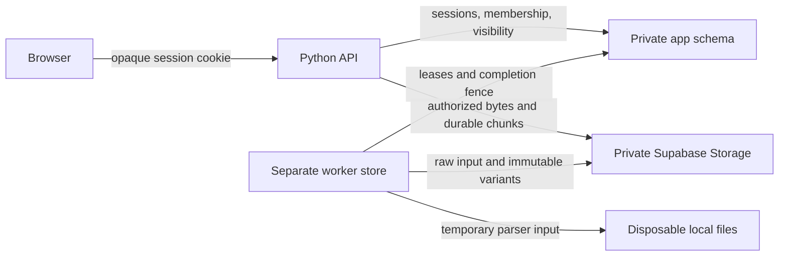

# Storage and shared-entry grounding

This is a read-only code investigation at `39841e8a2697c6e8ca57cc6f4866665218c0ea84`, recorded on 14 October 2026. The recommendations below are designs, not implemented safeguards. Only this evidence file was written. No personal archive content was inspected and no hosted state was changed.

## Overview

The Python API owns authorization and opaque browser sessions. Persistent bytes currently live in six directories under `.mazi-imports`. Both the HTTP server and its background worker open separate `MemoryStore` instances against that root. Supabase must own durable data for both actors. Uploading a copy of completed previews would leave imports, resource originals, manual media, and worker recovery tied to one machine.

The approved D17 flow uses a shared code and a normalized visible name, without email or personal passwords. A private PostgreSQL application schema and backend-only private Storage preserve that flow. Supabase Auth can remain disabled for public signup until there is an explicit decision to adopt a different identity model. Hosted PostgreSQL sessions still satisfy a real app migration to Supabase, provided the decision is documented and nobody claims Supabase Auth is the active login provider.

## Where bytes live

The existing directory names can become object prefixes inside one private bucket. Preserve their keys to support archive migration and exports.

| Prefix | Current owner | Write and read behavior | Required hosted behavior |
| --- | --- | --- | --- |
| `originals/<media UUID>` | `Store` | Manual media upload writes original bytes. `media_bytes(..., original=True)` reads after owner or grant checks. | Immutable upload, authorized backend download, actual deletion after tombstone. |
| `previews/<media UUID>` | `Store` | Manual upload generates JPEG. `media_bytes` chooses original or preview by component. | Immutable upload and same component checks. |
| `uploads/<upload UUID>` | `Store` | Partial manual image assembled by offset. Successful finish removes it. | Durable chunk receipts and remote chunks before acknowledgment. |
| `archives/<run UUID>` | `ImportStore` | ZIP transfer, SHA-256 verification, inventory, and worker extraction. A source resource can also generate a ZIP here. | Durable raw input or durable component chunks accessible to API and worker. Materialize a temporary local ZIP only for parsing. |
| `archive-objects/<digest>.original` and `.preview` | `ImportStore` | Group and original SHA form a deterministic digest. Writes compare existing bytes. Worker completion links database rows. | Preserve keys and immutable checksum comparison. A database row becomes available only after both object uploads succeed. |
| `source-resources/<resource UUID>` | `SourceStore` | Partial resource upload. Unsupported formats remain here as `RETAINED_NO_PREVIEW`. | Persist all formats, including those without a preview. Backend download must still check resource withdrawal and contributor membership. |

Evidence is in `mazi/identity/core.py:131-146`, `:398-459`, `:486-503`, `:553-562`, `:584-593`; `mazi/imports/engine.py:76-79`, `:127-164`, `:173`, `:246-261`, `:267`, `:305-314`, `:488-490`; and `mazi/sources/sources.py:65-66`, `:198-258`, `:310-324`.

Capsule photographs are a seventh byte class, stored inside the database rather than those directories. `time_capsules.photo` is a SQLite BLOB today. A PostgreSQL `bytea` column is the smallest complete migration and keeps the photograph behind unlock checks. Moving capsule photos to Storage would require a separate private key namespace and an unlock-aware download path. See `mazi/memories/advanced.py:13-29`, `:71-119`.

Static `dist`, `land.geojson`, downloaded CLIP model files, and sample photographs are application assets or model cache. They do not need private archive Storage. `Archive` expects a `Path` and uses `zipfile.ZipFile` against that path. Temporary materialization is therefore a parser concern, not persistent archive ownership. See `mazi/server.py:14-15`, `:39-52`; `mazi/imports/adapters.py:46-53`; and `mazi/discovery/clip_encoder.py:18`.

## Request and worker flow

`mazi/server.py:57-63` constructs `MemoryStore(root)` for requests. It separately launches `mazi.sources.server.worker(root, stop)`. The worker constructs another `MemoryStore(root)` at `mazi/sources/server.py:107-109`. Both must receive the same validated backend configuration and open their own database connections. Avoid passing a request-thread connection into the worker.

The actual store hierarchy is `MemoryStore` through `AnswerStore`, `DiscoveryStore`, `SourceStore`, `ReviewStore`, `ImportStore`, and `Store`. Constructors install each domain schema. Startup initialization therefore touches all those classes, not just the identity base. Relevant constructors are at `mazi/memories/memories.py:28-32`, `mazi/discovery/discovery.py:84-88`, `mazi/sources/sources.py:59-66`, and `mazi/imports/engine.py:70-79`.

Every existing media route returns bytes through Python. `/api/archive/<id>/preview` and `/original` call `asset_bytes` at `mazi/imports/server.py:43-45`. Archive rendition at `mazi/archive/server.py:57` calls `rendition_bytes`. Review, discovery, answers, and memory exports build on `asset_bytes`, so changing that one authorized byte seam reaches those consumers. `/api/sources/original` uses `resource_bytes` at `mazi/sources/server.py:33-34`. Legacy manual media endpoints use `media_bytes` at `mazi/identity/server.py:88-93`.

Keep these endpoints. Do not return public URLs. A signed URL issued before withdrawal stays valid until it expires, so the strongest preservation of current immediate checks is backend-proxied private download with `Cache-Control: no-store`.

## Durability and concurrency seams

`ImportStore.write_chunk` checks current offset under `BEGIN IMMEDIATE`, compares repeated ranges, calls `fsync`, and then advances `received`. `resource_chunk` has the same structure. `upload_chunk` uses offset and byte comparison, but has weaker transaction coverage. Supabase Storage replaces a complete object, not a random-access filesystem file. A `Path` facade that downloads and reuploads the entire growing file for every chunk would preserve syntax but multiply transfer work. With 512 KiB chunks and a 128 MiB archive, cumulative uploads approach 16 GiB before processing.

The durable replacement should store immutable chunks under a transfer generation and offset, then commit a receipt in PostgreSQL. A receipt identifies transfer ID, generation, start offset, length, checksum, and object key. Lock the transfer row while accepting a chunk. Write remote bytes before advancing `received`. The receipt tells the worker which objects to assemble and lets the API compare any repeated accepted range, including retries that split an earlier chunk. A database rollback after remote upload leaves an unreferenced object, which is safe to retry or collect later. A remote failure must leave the receipt and `received` unchanged.

On completion, assemble chunks into a restricted temporary file and verify the exact declared size and SHA-256. Raw ZIPs can remain reconstructable from chunks, or be compacted into one verified immutable object before state advancement. Source JPEG/PNG input can become a synthetic ZIP in a temporary file and then a verified immutable `archives/<resource>` object. Unsupported source bytes must remain durable and downloadable even though no archive variant exists.

Transfer rows and worker leases are genuinely shared state. PostgreSQL row locks or conditional updates must protect those invariants across separate processes. Python `RLock` is insufficient. Immutable chunk keys separate concurrent writes. Duplicate variant writes use create-if-absent plus digest comparison, not last-writer-wins upsert. Storage documents that concurrent upsert chooses the last completing write. [Standard uploads](https://supabase.com/docs/guides/storage/uploads/standard-uploads).

`ImportStore.complete` already separates expensive preparation and its final lease fence, at `mazi/imports/engine.py:320-337`. Preserve the second fence after Storage writes. A stale or withdrawn job must never attach uploaded variants. `_asset` authorizes both the reader's current membership and at least one unwithdrawn contribution by a current member, at `:478-485`. A bytes cache must not bypass those database checks.

## Deletion, reconciliation, and backup

Manual deletion removes grants and marks media deleted before unlinking both files, at `mazi/identity/core.py:553-562`. Hosted deletion should keep the same visibility-first order, then delete objects through the Storage API. If deletion fails, retain a durable retry record. A successful tombstone must immediately deny reads while deletion retries.

Archive withdrawal is distinct from physical deletion. Origins and runs become withdrawn, and `_asset` denies an asset with no remaining active origin. Do not delete a shared asset while another active origin still references it. `reconcile` currently collects only unreferenced old files when no item is processing, at `mazi/imports/engine.py:518-527`. Hosted reconciliation must list all object pages and consider transfer receipts, raw inputs, manual media, and variants. A collector that examines only `archive_assets` can delete valid in-progress or unsupported resource bytes.

`mazi/archive/ops.py:17` names all six filesystem directories. Its backup copies SQLite and those directories, and verifies active original digests. That command cannot become a hosted backup by changing only the database connection. Hosted backup needs a consistent database snapshot plus Storage object export and checksums. Use maintenance mode or a single locked migration/backup boundary to stop writers. Preserve the local backup tool for local-source recovery or replace its CLI behavior explicitly. Free projects require owner-maintained exports. Supabase database backups omit Storage payloads. [Database backups](https://supabase.com/docs/guides/platform/backups).

## Shared entry and Supabase Auth

`docs/DECISIONS.md:50-54` requires shared code plus normalized name, remembered opaque session, one-time introduction, and unchanged profile ownership IDs. The owner accepts that a code holder can use another member's name. Treat that approved product behavior as a constraint, not an accidental bug to rewrite.

`enter_shared` normalizes the name, compares a hashed code, creates a profile/member if absent, and writes a hashed random session token in one transaction. `shared_session` checks expiry, current membership, and profile existence. See `mazi/identity/core.py:148-155`, `:213-242`, `:284-295`. Existing archives require explicit name-to-user UUID mappings. `setup_shared` refuses to silently change a configured group, at `:169-211`.

The recommended hosted mapping preserves these application tables and UUIDs in an unexposed `mazi` schema. A restricted backend database role and private Storage credential stay only in server configuration. Public Supabase Auth signup and anonymous signin remain disabled. Browser clients receive neither the backend database credential nor a service key. Deny `anon` and `authenticated` direct access to app tables and the archive bucket. RLS remains enabled for defense in depth, but document that the Python authorization path governs this D17 application and service credentials bypass Storage RLS.

Creating anonymous Supabase Auth users on every browser would create duplicate identities and fail existing-name resume. Generating hidden per-profile Auth passwords requires privileged cross-system credentials and a compensation workflow without improving the accepted shared-code trust model. A custom JWT bridge is a separate architectural change and must preserve immediate session revocation. None is required to migrate the app's persistent data to Supabase PostgreSQL and Storage.

## Current documentation check

The Supabase skill and current changelog were read. The 12 October TLS breaking change removes four CBC TLS 1.2 suites starting 10 November 2026. It affects Storage HTTP, but not direct PostgreSQL or pooler connections. The 25 September PostgreSQL minor upgrade concerns ltree, legacy pgcrypto encryption, btree_gist NaN indexes, and custom estimators. No such archive mechanism was found in this scoped tracing. Preserve TLS verification and confirm the deployed client on the real endpoint. [TLS change](https://supabase.com/changelog/cbc-tls-ciphers-deprecated), [PostgreSQL change](https://supabase.com/changelog/postgres-15-19-17-11-breaking-changes).

Private buckets apply access controls to downloads. Public buckets bypass retrieval checks. [Storage buckets](https://supabase.com/docs/guides/storage/buckets/fundamentals). Standard uploads support large objects but recommend resumable upload above 6 MB. Immutable small backend chunks fit the current endpoints without exposing browser credentials. [Standard uploads](https://supabase.com/docs/guides/storage/uploads/standard-uploads).

## Validation contract

The unchanged local baseline passed `.venv/bin/python -m unittest tests.backend.identity.test_shared_entry tests.backend.imports.test_engine`. It ran 24 tests in 3.615 seconds. This proves the existing contracts, not the hosted migration.

The implementation requires these observed checks:

1. Enter the same normalized name on two independent connections. Confirm one UUID, one introduction state, and concurrent first-entry uniqueness. Confirm failed session creation rolls back a new profile. Confirm expired, logged-out, and removed-member sessions fail.
2. Accept manual, archive, and source chunks. Restart API and worker with fresh temporary directories. Resume and finish from remote bytes. Confirm identical retry ranges succeed, conflicting ranges fail, and checksum mismatch restarts correctly.
3. Import a synthetic ZIP through HTTP. Process on a separate worker connection. Clear all local work files. Read preview, original, rendition, discovery visual input, answer evidence, slideshow, and export through the real endpoints.
4. Retain an unsupported source format without a preview. Clear local files and confirm the original downloads. Withdrawal and departure must deny it immediately.
5. Force remote upload failure, database commit failure after upload, stale worker lease, and process interruption. No item may become available without both verified objects. Retrying must converge without duplicate origins or conflicting bytes.
6. Confirm public bucket URLs, unauthenticated download, anonymous table access, and a member from another group all fail. Inspect the built browser bundle and requests for server credentials.
7. Delete manual media. Confirm read denial before remote cleanup, deletion retry after failure, and remote removal. Confirm withdrawal preserves a variant with another active origin.
8. Export a database snapshot and every required Storage payload with checksums. Restore to a clean target. Confirm sessions, origin ownership, active originals, unsupported resources, and partial transfer resume.

The narrow reads used `rg` and `nl` across `mazi`, `scripts/run-app.mjs`, and the canonical D17 decision. No HTTP/cloud checks were run by this investigator.
